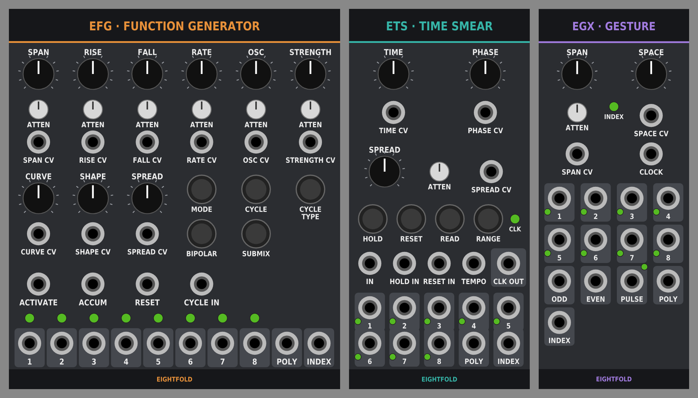

# Eightfold for VCV Rack

Eightfold is three 8-channel modulation modules for VCV Rack 2.

| Module | What it does | Inspired by |
|---|---|---|
| **EFG** Function Generator (22 HP) | Eight rise/fall functions, each with an oscillation enveloped by its function. One gate fires them through four span modes | Make Noise PoliMATHS |
| **ETS** Time Smear (12 HP) | One CV in, eight copies out. Each copy plays back a shared buffer at its own speed and phase | Make Noise MultiMod |
| **EGX** Gesture Extractor (10 HP) | Turns the motion of a CV, or a Channel Index signal, into eight channel gates, odd/even gates and a change pulse | Make Noise GTE |

These are independent behavioural re-imaginings, written from the public manuals of modules that Make Noise currently makes and sells. They are not affiliated with or endorsed by Make Noise, they don't use Make Noise's names or artwork, and they are not circuit models. Where a manual leaves a number out, Eightfold uses an estimate; the list is at the end of this manual.

## Ideas shared by all three

**Eight channels.** Every module has eight numbered outputs, each with its own light, plus a **POLY** output that carries all eight on one polyphonic cable. POLY is the easy way to drive an 8-voice poly VCA, low pass gate or oscillator.

**Channel Index.** The three modules talk to each other with a single voltage that names a channel: **0.5 V per channel** (channel 1 = 0.5 V, channel 8 = 4 V, 0 V = none). Every module has an **INDEX** output. EFG and EGX can also receive it:

- EFG: set **SPAN** to the centre and its **ATTEN** fully clockwise, then patch an index into **SPAN CV**. The MODE light goes bright white. Each new index fires that channel.
- EGX: set **SPAN** fully anticlockwise, **ATTEN** and **SPACE** fully clockwise. The INDEX light comes on. Each new index lights that channel's gate.

When several channels start at the same moment, the index is sent as a quick **flam**: each channel for 5 ms in turn, lowest first, with the last one staying on. Re-sending the same channel drops the output to 0 V for 1 ms first, so the receiver sees a new event. If you need the Make Noise MultiMod's printed 1 V-per-channel scale, each module's right-click menu has a "Channel Index scale" option.

**Gates** are read on a rising edge above 2 V. **Buttons** keep their state in the patch.

---

## EFG Function Generator

### What happens

Each of the eight channels is a function generator: when it is **activated** it rises from where it is to full, then falls back to zero. The **CURVE** knob bends both segments. Mixed into the function is an **oscillation** (a variable-shape wave) whose size follows the function, so it can be anything from a plain envelope to a tremolo burst to an enveloped audio-rate tone. **STRENGTH** scales the result to ±9 V.

What decides **which** channels an ACTIVATE gate fires is **SPAN** and the **span mode**, set with the **MODE** button.

### Span modes (MODE button)

| Light | Mode | ACTIVATE gate does | SPAN knob sets | RESET |
|---|---|---|---|---|
| White | **Index** | Fires the channel SPAN points at | Which channel: centre is none, right of centre 1 to 8, left of centre 8 down to 1 | Re-fires the selected channel |
| Yellow | **Round** | Fires the next channel in turn | Step size 1 to 7; left of centre steps backwards | Next gate fires channel 1 |
| Cyan | **Parallel** | Every channel counts gates and fires on its own division | How far apart the divisions are; at full right channel 1 fires every gate and channel 8 every 16th. Left of centre mirrors | All counters restart: next gate fires every channel |
| Magenta | **Binary** | A counter steps on each gate; each channel follows one bit of it | The channel that fires every gate; neighbours fire half as often, the next ones in runs of two, four and so on | Counter back to zero |

In **Index** mode with nothing in ACTIVATE, simply turning SPAN fires each channel as the cursor reaches it.

### Controls

| Control | What it does |
|---|---|
| SPAN, ATTEN, SPAN CV | See above. ATTEN scales SPAN CV (5 V = the knob's full travel) |
| RISE / FALL | Rise and fall times, 0.5 ms to about 33 s on the knob, up to about 20 minutes with CV |
| RATE | Oscillation speed: 4 s per cycle to about 40 Hz, or 2 Hz to 2 kHz in Bipolar |
| OSC | How much oscillation is mixed in. Fully anticlockwise is a plain function; fully clockwise is the oscillation at full size inside the function |
| STRENGTH | Output level and polarity, −9 V to +9 V. Centre is silent |
| CURVE | Log (fast start) at left, linear at centre, exponential (slow start) at right. Affects all channels at once |
| SHAPE | Oscillation wave: falling saw, triangle at centre, rising ramp. SHAPE CV beyond the knob's range blends into noise |
| SPREAD | Weights the attenuverters by channel, see below |
| CYCLE | Keeps channels running by themselves |
| CYCLE TYPE | **All** (purple): every channel re-fires itself at the end of its fall. **Follow the leader** (pink): the end of one channel's fall fires the channel to its right (8 wraps to 1); the chain has to be started by an activation |
| CYCLE IN | A high gate turns cycling on while the CYCLE button is off |
| ACCUM | While patched, activations are held (orange light) and all fire together on the next ACCUM gate |
| BIPOLAR | Oscillation around 0 V at a higher rate range, for vibrato, FM or audio |
| SUBMIX | Each patched output carries its own channel plus every unpatched channel to its left. Overloads fold back (unipolar) or soft clip (bipolar). POLY always carries the eight separate channels |

### Spread and per-channel CV

Rise, Fall, Osc and Strength each have an attenuverter and a CV input, and they work in one of two ways:

- **CV input empty: Spread.** SPREAD sets a weight for each channel: turned right, channel 8 gets the most and channel 1 none; turned left, the reverse. Each attenuverter then adds its own amount times that weight. With SPREAD at centre the attenuverters do nothing. SHAPE is spread too, at a fixed depth. One knob can therefore stagger up to five settings across eight channels.
- **CV input patched: sampled per channel.** The CV is read at the moment each channel is activated and that channel keeps the value until its next activation (Make Noise calls this "modulation dissemination"). One slow LFO into RISE CV gives every hit its own rise time. RATE CV works this way too, and at full attenuverter it tracks 1 V/oct.

### Channel lights

Green for a positive output, red for negative, brightness by level; orange while held by ACCUM; dim white on the channel the SPAN cursor points at; blue on idle channels showing their Spread weight.

### Right-click menu

Span mode, cycle type, bipolar, submix, Channel Index scale, and "Reset all channels".

---

## ETS Time Smear

### What happens

The input is recorded continuously into a loop whose length is set by **TIME** (50 ms to 30 s). Eight playback heads read that loop. **SPREAD** gives each head its own speed, **PHASE** spaces them apart in time, and the **READ** shape sets the direction they read in. With SPREAD at centre, PHASE at zero and the Ramp read shape, all eight outputs are exact copies of the input. Raise PHASE and the copies become delayed versions of each other, up to half the loop apart. Turn SPREAD and the heads drift at different speeds, so the copies stretch, compress and jump where a head crosses from old material into new.

With **nothing in IN**, ETS runs an internal LFO instead: eight copies of one LFO at the speeds and phases set by SPREAD and PHASE.

### Controls

| Control | What it does |
|---|---|
| TIME, TIME CV | Loop length: 50 ms to 30 s. TIME CV adds to the knob, 0 to 5 V covering the knob's travel. Longer times give PHASE and SPREAD more depth and make changes take longer to reach the outputs |
| PHASE, PHASE CV | 0: all heads together. Full: channel 8 half a loop behind channel 1. With PHASE CV patched the knob scales it; up to 10 V keeps going, negative reverses the order |
| SPREAD, ATTEN, SPREAD CV | Speed per channel. Right: channel 1 up to 8× faster, channel 8 down to 8× slower, middle channels change least. Left mirrors it. CV can push the ends to 24× |
| HOLD, HOLD IN | Stop recording and loop what is there. TIME still stretches or squeezes the loop. HOLD IN holds while its gate is high. On the internal LFO, Hold freezes the outputs |
| RESET, RESET IN | Bring all heads back into line (blue flash) |
| READ | Read shape, see below |
| RANGE | Internal LFO range: 0 to 10 V (green), ±5 V (purple), 0 to 5 V (blue) |
| TEMPO | Clock in: snaps TIME to 1 to 32 clocks, speeds to whole multiples or divisions, and PHASE to sixteenths |
| CLK OUT | A pulse every loop length |

### Read shapes (READ button)

| Light | Shape | Buffer | Internal LFO |
|---|---|---|---|
| Red | Ramp | Forward: true copies | Rising ramp |
| Green | Saw | Backward: reversed copies | Falling saw |
| Blue | Triangle | Forward then back | Triangle |
| Purple | Sine | Forward then back, slowing at the turns (wow and flutter) | Sine |
| Pink | Stairs | Reads in eight held steps | Square |
| Orange | Step random | Each cycle, picks a random spot and holds the value there | Stepped random |
| Yellow | Ramplets | Each cycle, jumps to a random spot and plays forward from it | Smooth random |

### Lights

Channel lights show each head's speed: aqua near 1×, green faster, blue slower, hot pink faster than 8×, yellow slower than 8×. The CLK light flashes each loop; without TEMPO its colour shows the loop length (red short, then orange, yellow, green long; purple or blue when CV pushes past the knob), with TEMPO it shows the clock ratio (green for 1, 2, 4, 8…, red for multiples of 3, gold for others).

**INDEX** sends the channel whose copy is currently highest.

### Right-click menu

Read shape, LFO range, Channel Index scale, "Clear buffer".

---

## EGX Gesture Extractor

### What happens

EGX splits a voltage range into eight bands, one per channel. Whichever band the input sits in, that channel's gate is high. As the input moves, the gates change, so the **motion** of any signal becomes rhythm: a slow LFO walks up and down the eight gates, a jittery random hits them all, a still signal gives one steady gate. **SPACE** sets how many volts it takes to cross all eight bands, from 10 V (fully clockwise) down to 50 mV, so it sets how busy the gates are. Below 0 V or above the range, no gate is high. A little hysteresis keeps a slow or noisy signal from chattering on a band edge.

### Controls

| Control | What it does |
|---|---|
| SPAN | Offset added to the input, ±5 V: moves which band the signal sits in |
| ATTEN, SPAN CV | The signal being watched and its level and polarity |
| SPACE, SPACE CV | Volts needed to sweep all eight channels: 50 mV to 10 V |
| CLOCK | When patched, the gates change only on clock edges |
| 1 to 8 | One gate high at a time, or none |
| ODD / EVEN | High while the active channel is odd / even |
| PULSE | A 1 ms trigger every time the channel changes: faster motion, more pulses |
| POLY, INDEX | All eight gates on one cable; the active channel as a Channel Index |

**Index mode:** SPAN fully anticlockwise with ATTEN and SPACE fully clockwise (INDEX light on) reads SPAN CV as a Channel Index from EFG, ETS or another EGX.

### Right-click menu

Channel Index scale, gate level (10 V or 5 V), and "Pulse when leaving the range".

---

## Patch recipes

The NUSS gets its voices from an 8-voice wavetable oscillator and two 4-channel low pass gates. Eightfold doesn't include those, so these recipes use modules from Rack and the free Library: **VCV VCO** or **WT VCO** set to 8 polyphony channels, **Bogaudio LLPG** or **VCV VCA + VCF** as the low pass gate, **VCV Mix** or **Bogaudio Mix8**, **VCV Quantizer**, and **VCV Split/Merge** to get between POLY and single cables.

### 1. Eight-voice plucks from one gate
EFG in **Round**, step 1. Clock into ACTIVATE. EFG POLY → poly VCA/LPG CV. A poly VCO (8 channels, each tuned with a poly constant or quantised random) → LPG audio. RISE short, FALL medium, SPREAD right with FALL ATTEN up so the later channels ring longer.

### 2. Polyrhythmic envelopes
EFG in **Parallel**, a clock into ACTIVATE, SPAN fully right. Outputs 1 to 8 to eight destinations (filter, wavefolder, pan). Every channel moves at its own division; RESET from a bar clock to realign.

### 3. Binary bursts
EFG in **Binary**, OSC at about 0.6, Bipolar off, RATE up. Each hit is a tremolo burst; channels further from SPAN's channel fire in longer runs, so the texture thins out across the outputs.

### 4. Follow-the-leader drone swell
EFG CYCLE on, type **Follow the leader**, long RISE and FALL, one gate to start it. A swell walks around the eight outputs forever. Patch STRENGTH CV with a high voltage to push channels past full and get steady offsets.

### 5. Eight enveloped oscillators
EFG **Bipolar** on, OSC full, RATE about half, RATE ATTEN full right, a MIDI-CV pitch into RATE CV. Gate into ACTIVATE in Round mode. RISE short, FALL medium. Each note goes to the next channel at its own pitch: an 8-voice enveloped synth from one module.

### 6. Dissemination sequencing
EFG in **Round**, a slow random into STRENGTH CV with ATTEN full. Each channel's level is set at the moment it is hit and stays until its next turn.

### 7. ETS canons (shift register)
ETS: SPREAD centre, PHASE 0, a sequencer's CV into IN, its clock into TEMPO, TIME fully left. Outputs → VCV Quantizer → eight VCO pitch inputs. Raise PHASE: each voice plays the melody later than the one before.

### 8. Snap focus
A clock into ETS TEMPO, SPREAD off centre, an 8th division of that clock into RESET. The copies drift apart and snap back into line on every reset.

### 9. Noise spectrum
White noise into ETS IN, TIME short, outputs to a mixer. TIME and SPREAD pitch the copies against each other: gritty, lo-fi drum colours.

### 10. Weighted random gates
A pulse wave into ETS IN, READ on **Step random**. Each output picks random points of the wave: the pulse width sets the chance of a gate.

### 11. Eight related clocks
ETS with nothing in IN, READ on **Stairs**, SPREAD to taste: eight square-wave clocks at multiples and divisions. Add TEMPO to lock them to whole ratios.

### 12. The loudest copy fires the envelope
ETS INDEX → EFG SPAN CV, EFG in Index with SPAN centre and ATTEN full right. Whichever ETS copy is highest fires its EFG channel. Also try ETS's internal LFOs into EFG SPREAD CV.

### 13. Gesture rhythms
An ETS copy (or any slow random) into EGX SPAN CV, SPACE about a third. Gates 1 to 8 to drum triggers, PULSE as a clock that speeds up with the motion, ODD and EVEN to two voices for call and response.

### 14. All three
ETS internal LFO → EGX SPAN CV → EGX INDEX → EFG SPAN CV (Index receive). One slow LFO's movement chooses which of eight envelopes fires.

---

## Estimates

Make Noise's manuals describe behaviour but leave many numbers out. Eightfold uses these; all live in `src/dsp/Constants.hpp`, so they can be tuned by ear.

| What | Value |
|---|---|
| EFG rise/fall range | 0.5 ms to about 33 s on the knob, about 20 min with CV |
| EFG curve | power law, exponent 1 to 5; ends of the knob lengthen time by up to 50% |
| EFG rate | 0.25 to 40 Hz unipolar, 2 Hz to 2 kHz bipolar |
| EFG Parallel divisions | up to /16 on the knob, /23 with CV (the original's table wasn't readable) |
| EFG Binary | channels left of the SPAN channel follow a mirrored counter |
| EFG strength past full (submix off) | crossfades to steady DC by twice full strength |
| CV scaling for knobs | 5 V = full knob travel |
| Channel Index flam | 5 ms steps, 1 ms gap before a repeated index |
| ETS buffer | 16384 slots |
| ETS stairs | 8 steps |
| ETS index hysteresis | 2 ms |
| ETS HOLD IN | held while the gate is high |
| EGX range | 50 mV to 10 V, bands from 0 V, 2% hysteresis |
| EGX gates and pulse | 10 V gates, 1 ms pulse |
| EGX INDEX out | added: the original has none |
